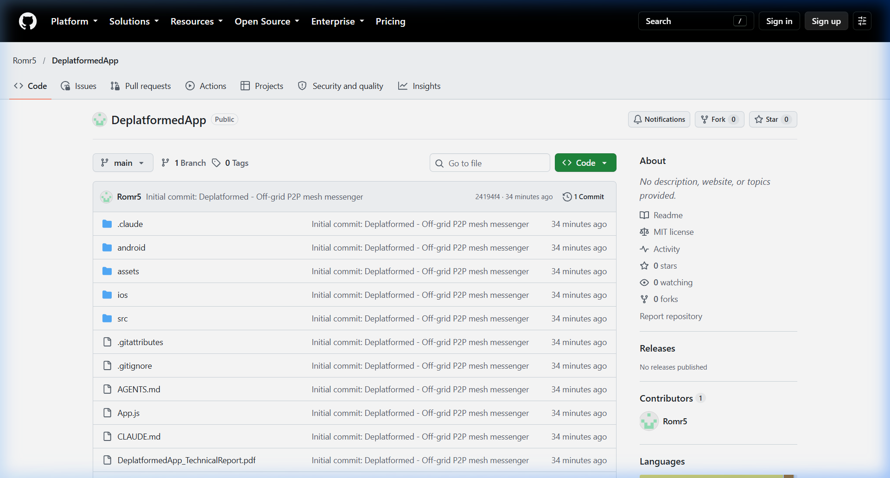

# GitHub Project Submission

---

## 1. Project Information & Repository Link

* **Project Name:** De-Platformed (Demaline / Meshline)
* **Description:** Off-Grid, Zero-Internet P2P Mesh Messenger & Emergency Communication Network
* **Project GitHub Link:** [https://github.com/Romr5/DeplatformedApp](https://github.com/Romr5/DeplatformedApp)
* **Author / Account:** [Romr5](https://github.com/Romr5)
* **Default Branch:** `main`
* **Technologies:** React Native 0.86.3, Expo 57, Google Play Services Nearby Connections (`play-services-nearby:19.3.0`), QuickCrypto (ECDH P-256 + AES-256-GCM), CRDT Store-and-Forward Queues.

---

## 2. Necessary Screenshots and Explanations

### Screenshot 1: Official GitHub Repository Overview

#### 📝 Explanation & Breakdown:
* **Repository Architecture:** The repository at [https://github.com/Romr5/DeplatformedApp](https://github.com/Romr5/DeplatformedApp) contains the complete production-ready source code, organized cleanly into standard React Native / Expo directory hierarchies:
  * `src/`: Houses all application logic, including the global coordinator (`AppContext.jsx`), screens (Mesh Radar, Chat, Private Conversations, Rooms, Bulletin, SOS Help, Map, Settings), cryptographic protocols (`x3dh.js`, `doubleRatchet.js`, `groupCrypto.js`), and mesh transport relays (`NearbyTransport.js`, `RelayEngine.js`).
  * `android/`: Native Android module (`NearbyModule.java`) that bridges Google Play Services Nearby Connections API for offline radio management (BLE & Wi-Fi Direct).
  * `ios/`: Native iOS workspace configured for future multiplatform mesh routing.
* **Security & Credential Integrity:** In strict compliance with security standards, all private keys, signing keystores (`debug.keystore`, `*.jks`, `*.keystore`), certificates, and local environment files are completely excluded from the repository via a hardened `.gitignore` configuration.
* **Documentation & Specifications:** Includes detailed architectural specifications and design reports (`PROJECT_DOCUMENTATION.md`, `Meshline_Architecture_v2.pdf`, and `DeplatformedApp_TechnicalReport.pdf`).

---

### Screenshot 2: Mobile Client Interface & Live P2P Mesh Messaging

#### 📝 Explanation & Breakdown:
* **100% Offline Mesh Operation:** The mobile client operates without internet connectivity, cellular networks, SIM cards, or centralized servers. Devices directly communicate over local radio frequencies.
* **Radar Discovery & Real-Time Connection:**
  * Uses Bluetooth Low Energy (BLE) for zero-configuration discovery of nearby peers.
  * Dynamically negotiates high-bandwidth Wi-Fi Direct and local hotspot links for high-speed messaging, audio notes, and media transfer up to 100 meters per direct hop.
* **Interactive Security & Trust Handshake:**
  * Displays native pair request prompts (`Reject ❌` vs `Accept & Trust ✅`) when an unknown device attempts to join the local mesh.
  * Once trusted, peer identities and public keys are securely cached in local device storage (`AsyncStorage`), enabling instant zero-touch auto-reconnection whenever peers move back into radio range.
* **Store-and-Forward CRDT Messaging:** Messages sent to out-of-range contacts are buffered locally in an append-only Conflict-Free Replicated Data Type (CRDT) queue and automatically flushed the moment the peer comes back into range.

---

### Screenshot 3: Project Identity & Off-Grid Mesh Concept

#### 📝 Explanation & Breakdown:
* **System Concept:** The Demaline / De-Platformed branding represents decentralized connectivity in communications-denied environments—such as natural disasters, emergency grid failures, remote expeditions, or localized censorship.
* **Emergency Distress & Bulletin Systems:**
  * **SOS Emergency Beacon:** Broadcasts geolocated distress signals across the mesh with audible alerts and priority packet routing.
  * **Public Bulletin Board:** Provides community announcement broadcasting with optional cryptographic admin signatures to prevent tampering or misinformation during emergencies.
* **Multi-Hop Mesh Relaying:** Incorporates an ad-hoc packet relay engine allowing intermediate devices to act as repeaters, extending the physical range of communication across chains of connected phones.

---

## 3. Technical Specifications Summary

| Feature Category | Implementation Details |
|---|---|
| **P2P Transport Layer** | Google Play Services Nearby Connections API (`NearbyModule.java`) |
| **Radio Protocols** | Bluetooth LE (discovery/advertisement) + Wi-Fi Direct (data transfer) |
| **End-to-End Cryptography** | ECDH P-256 Key Exchange, AES-256-GCM Payload Encryption, X3DH, Double Ratchet |
| **Group Security** | Sender-Key distribution protocol for encrypted multi-peer room messaging |
| **Offline Synchronization** | Store-and-forward CRDT message queue with `AsyncStorage` |
| **UI Framework** | React Native 0.86 with Expo 57, dark-mode styling, and gesture-driven tab facade |
| **Target Platforms** | Android (standalone offline bundle) with cross-platform Expo architecture |
